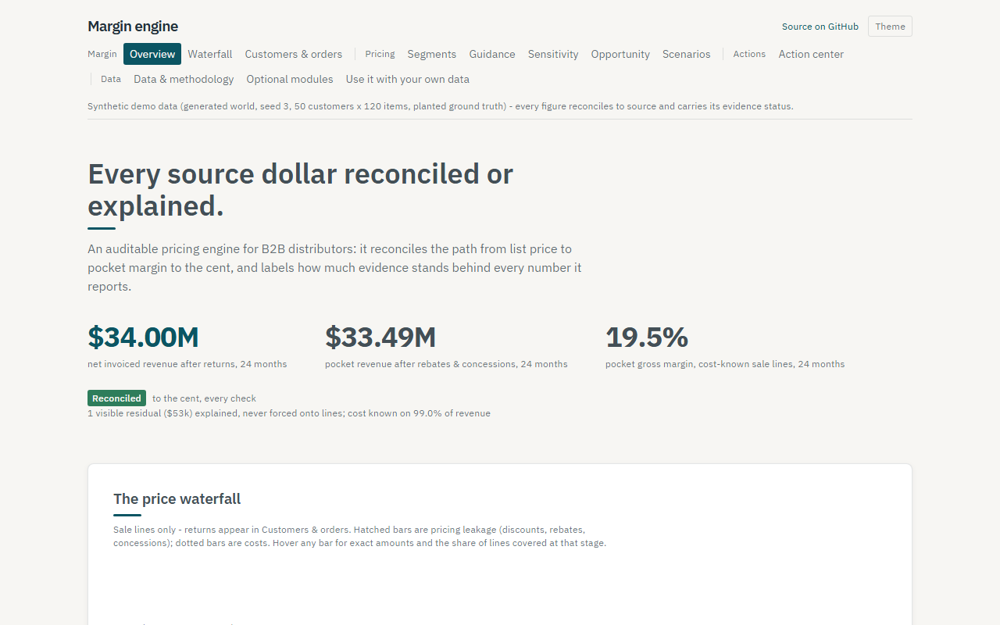
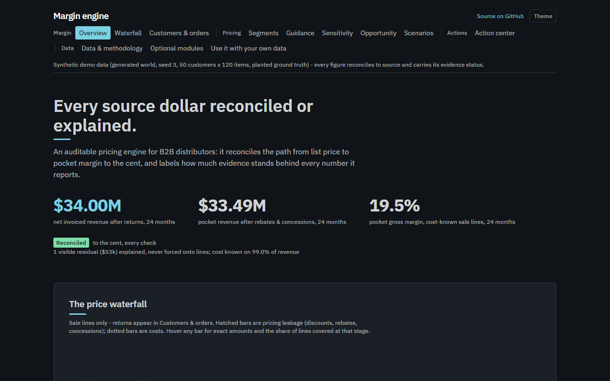
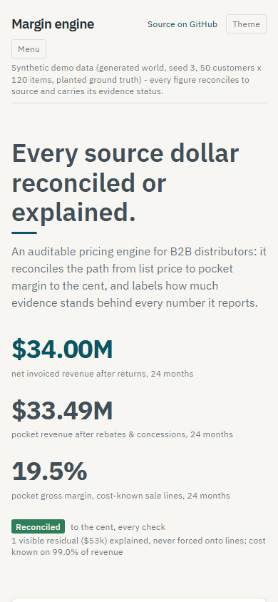
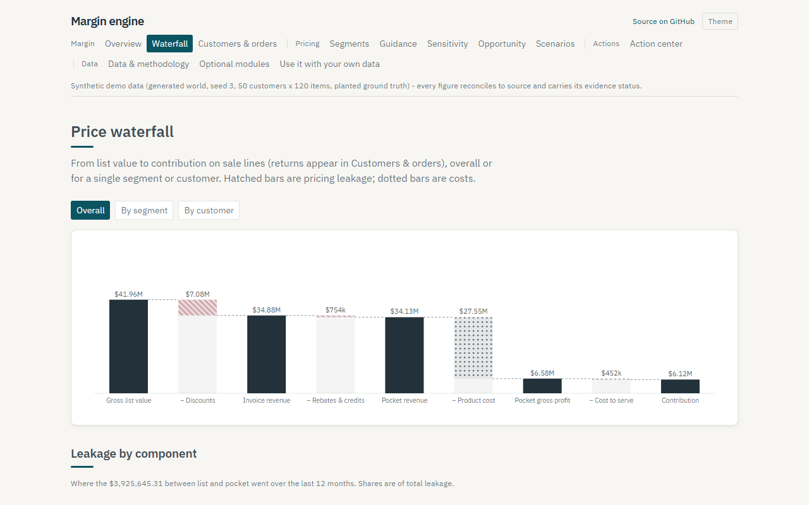
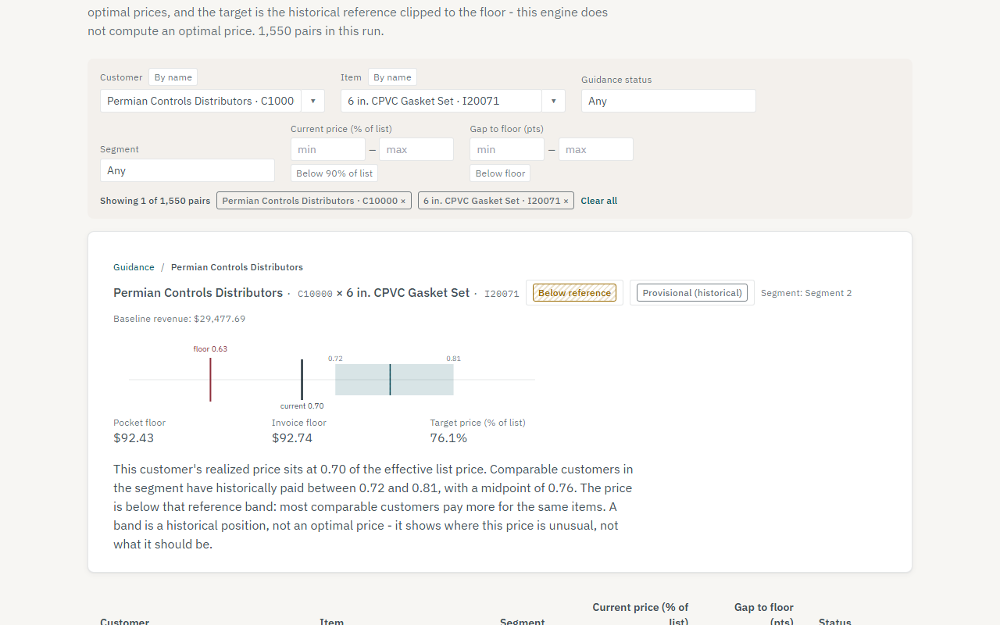
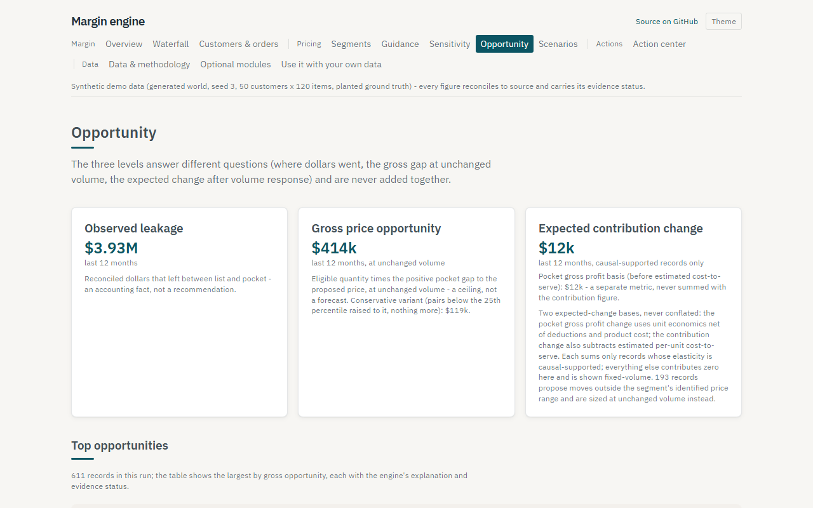
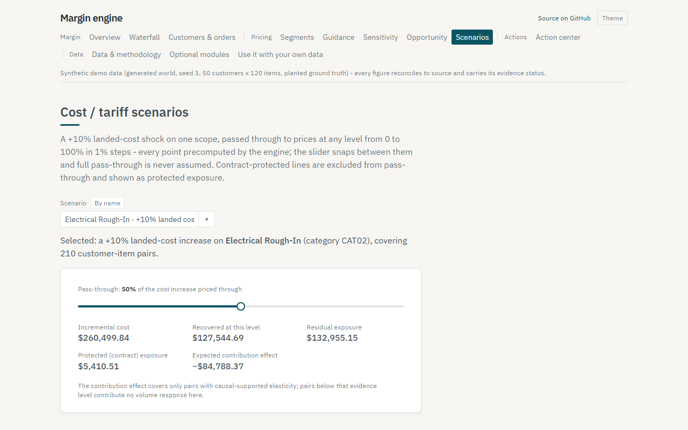
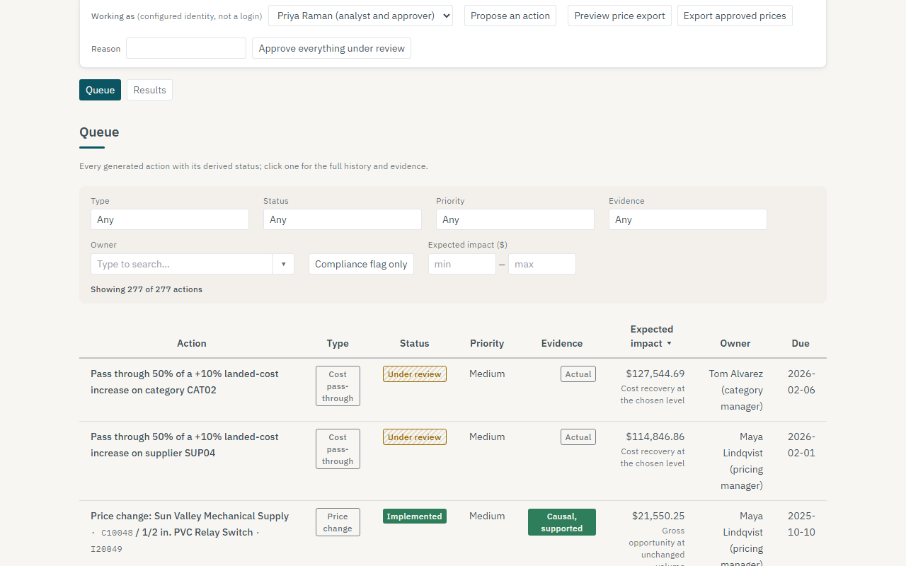
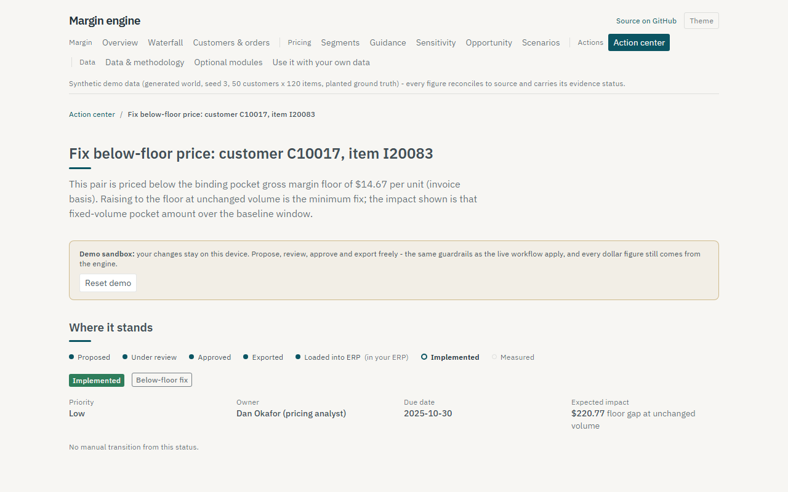

# Margin Engine

**Where is your margin going, and how much of the answer can you trust?**
Margin Engine reads an ERP invoice export, reconciles every dollar from list price to contribution, and shows what each customer really pays — with the evidence behind every number stated in plain English.

**[Open the live demo](https://jjdlg45.github.io/margin-engine/)** — no install, no sign-up. It runs on a synthetic world with planted ground truth, so every figure can be checked against a known answer.

[](https://jjdlg45.github.io/margin-engine/)

Built for industrial, electrical, HVAC, plumbing and foodservice distribution: any business with negotiated prices.

---

## What it does

### Every source dollar reconciled or explained

Distributor pricing data is messy — returns, credit memos, duplicates, missing costs, mixed units — and most tools quietly drop what they cannot place. This one does not. Every revenue line, deduction and cost reconciles to source totals in integer cents; allocations use the largest-remainder method so each line sums back to its source; and anything that cannot be allocated stays on the page as a visible residual with a plain-English reason. No dollar is silently dropped, and nothing is forced onto a SKU to make a report look complete.

Two more rules sit beside it:

- **Proven, not claimed.** A generator plants known truth — segments, elasticities, rebates, outliers, the direction of rep-discounting bias, instruments — and the test suite measures how much of it comes back, across seeds nobody tuned against. The [validation table](#validation-results) is generated from those measurements.
- **Fail closed.** Where the data does not support a result, the engine says so instead of printing a confident-looking number. That is why the demo shows statuses like `insufficient_data` and `descriptive_elasticity` beside numbers that would look perfectly plausible.

| It answers | On the page |
|---|---|
| Where is margin leaking — discounts, rebates, freight, returns? | Price waterfall: list → invoice → pocket → gross profit → contribution |
| Who pays far more or less than comparable customers for the same item? | Peer-group dispersion and outlier flags |
| Which customer × product groups behave alike on price? | Commercial segments from context features only |
| What is this pair's reference band, and what is the lowest price that still clears minimum margin? | Price guidance with an economic floor |
| How does volume respond to price — and is that causal or only descriptive? | Price sensitivity with an evidence status |
| How much is recoverable at unchanged volume, and how much after the volume response? | Opportunity at three levels, never summed |
| What happens to margin at 0–100% cost pass-through? | Cost and tariff scenarios |
| Which findings became decisions, and did they work? | Action center: propose → review → approve → export → implement → measure |

**Optional modules** switch on when their input exists and say so when it does not: multi-currency, customer hierarchies and price-protected contracts, tiered retrospective rebates, kits and free goods, activity-based cost-to-serve, inventory costing (standard / average / FIFO / LIFO), key-value-item detection, quote win/loss curves, and cross-price effects within substitution groups. Periods follow a configurable fiscal calendar: calendar months, 4-4-5 / 4-5-4 / 5-4-4, or a custom table.

<p>
  
  
</p>

---

## A 5-minute walkthrough of the demo

Six stops in the [live demo](https://jjdlg45.github.io/margin-engine/). Every figure below comes from the engine's own exports on a fixed synthetic world (seed 3, 50 customers × 120 items); the browser formats and filters, and never recalculates a financial number.

### 1. Overview — what happened, and how much of it is solid


The headline is the reconciliation, not a KPI: **every source dollar reconciled or explained**. Underneath it, the price waterfall is the signature visual, data coverage says what share of lines each metric could use, and the key findings link to the page that proves them.

### 2. Waterfall — where the money goes between list and contribution



On the demo world, **$41.96M of gross list value** becomes $34.88M invoiced, $34.13M pocket, $6.58M pocket gross profit and **$6.12M contribution**. Hatched bars are pricing leakage; dotted bars are costs. Switch between overall, one segment and one customer, and read the leakage split by component underneath. Returns are excluded from the sales view but never from the ledger — their economic effect is kept, which is why both views reconcile to the same source totals.

### 3. Price guidance — one customer, one item



Pick a pair and you get its band: the floor, the reference band from comparable customers, and where this price actually sits. Here the customer pays **0.70 of list** where comparable customers in the segment have historically paid **0.72 to 0.81** — below the band, above the floor of 0.63.

The explanation under the chart says what the band is *not*: a historical position, not an optimal price. The target is labeled **Provisional (historical)** because that is all it is — the midpoint of what similar customers paid, never below the floor. The engine ships without a computed optimal price at all; see [Honest limits](#honest-limits).

### 4. Opportunity — three answers to three different questions



**Observed leakage ($3.93M)** is an accounting fact: reconciled dollars that left between list and pocket. **Gross price opportunity ($414k)** is the gap to the proposed price at unchanged volume — a ceiling, not a forecast. **Expected contribution change ($12k)** is the only figure that models a volume response, and it counts only records whose elasticity is causal-supported and whose proposed move sits inside the price range the instruments actually identified.

They are never added together. The distance between $414k and $12k is the honest gap between "what this is worth if nothing moves" and "what there is evidence will happen".

### 5. A scenario — a cost increase, and how much of it you can pass through



Pick a scope and a pass-through level. The slider snaps between points the engine precomputed, because the browser never runs the model. At 50% pass-through of a +10% landed-cost increase on one category: **$260,499.84 incremental cost, $127,544.69 recovered, $132,955.15 residual exposure**, with contract-protected exposure shown separately. Full pass-through is never assumed.

### 6. Action center — propose, approve as someone else, export the price file



Findings become reviewable actions with an owner, a due date, an evidence status and an expected impact at the right opportunity level. Try the loop in the demo sandbox (your changes stay in your browser; there is a Reset demo button):

1. **Propose an action** — guardrails apply as they would live: nothing below the binding floor, contract-protected pairs blocked with the reason shown.
2. **Switch identity** with the "Working as" selector and **approve** it. An approver cannot approve their own proposal, and approving a price-discrimination review flag requires a written justification.
3. **Export approved prices** — an ERP-importable price file carrying effective date, previous price, new price, UOM and the approval id. Re-exporting rewrites identical bytes.



Each action shows where it stands — proposed, under review, approved, exported, loaded into ERP, implemented, measured — with the full event history behind it. Status is replayed from an append-only log, never edited in place. Once implemented, results tracking compares what happened against what was predicted.

---

## What it can and can't tell you

Every model output carries an evidence status, and the status decides what the engine will do with the number.

| Status | In plain English | What the engine does with it |
|---|---|---|
| `causal_elasticity_supported` | The prespecified diagnostics and documented assumptions passed, for this estimand and scope | Models a volume response, inside the identified price range |
| `iv_estimated_elasticity` | Instrumented, but at least one criterion did not pass | Shows a labeled sensitivity range, never a point forecast |
| `descriptive_elasticity` | An association in the data, not a response to price | Reports it; never prices from it |
| `insufficient_data` | Not enough here to estimate anything | Says so, and leaves the figure out |
| `price_response_shape_untested` | One elasticity may not describe the whole segment, and the test could not tell | Holds volume steady beyond a narrowed band around the observed prices |
| `outside_price_support` | The proposed move is beyond the price variation the instruments induced | Sizes it at unchanged volume |
| `cost_unavailable` | The source has no cost for this line | Excludes it from cost-dependent metrics, and counts it |
| `provisional_historical` | A target from what comparable customers paid | Uses it as a reference, never as an optimum |

**Fail-closed is the default, and it costs the demo something.** Both quote win curves fall to `insufficient_precision` once standard errors stop treating 676 quotes from 24 customers as independent. Of 611 opportunity records, **193 propose moves outside their segment's identified price range** and are sized at unchanged volume, and **60 more** are held at unchanged volume because the price-response shape could not be tested. One segment reaches a causal label — and the page says beside it that the constant-elasticity assumption behind that label is untested rather than confirmed.

What it **cannot** tell you is whether a price increase will work on *your* customers. Nothing here is validated against a real company's outcomes. The synthetic worlds show that the estimators recover truth they were given; the results tracker is the route to real evidence, and it reports "not enough implemented actions yet" until there are enough.

---

## Use it with your own data

No code changes are needed for a new source system. The engine reads **line-level invoice exports** — one row per invoice line, CSV or .xlsx. PDFs and scans need an extraction step first.

```bash
uv sync

# 1. See what your export actually contains
uv run margin-engine profile your_export.csv

# 2. Draft a mapping; every guess is marked # CONFIRM
uv run margin-engine draft-mapping your_export.csv

# 3. Run it
uv run margin-engine run --data your_export.csv --mapping config/mappings/yours.yaml --out output
# open output/report.html; tables are also in output/*.csv and *.parquet
```

The engine **refuses to run** while any guessed field is still unconfirmed, and refuses to compute anything whose meaning you did not declare — the sign convention of every amount, whether discounts are embedded, what the cost basis includes, or the honest absence of a cost. Suggestions never become silent decisions.

Physical format is declared, never guessed: delimiter, encoding, currency symbols, negative format (`-113.57` or `(113.57)`), decimal separator, whitespace. Options set globally can be overridden per file. A wrong declaration fails with the likely cause and the option to set.

Three tools exist for real deployments:

- **Monthly GL variance check.** Map an optional `gl_totals` table and the report compares engine period totals to the books — net sales and COGS separately, with signed and absolute variances, the tolerance used, the fiscal-period and account mappings, and a line-to-GL trace sample. Variances outside tolerance are flagged, never hidden; with no GL file it reports *not testable* rather than implying a pass.
- **Validation without planted truth.** A temporal backtest, placebo tests and rolling-window stability — all informational, and on the real case study below they correctly argue *against* causal claims.
- **Anonymizer.** `margin-engine anonymize` replaces customer, item and supplier IDs and names with salted keyed hashes (referential integrity preserved) and can scale money by a secret factor. The salt never appears in any output or manifest.

**On real public data.** The engine runs end to end on the UCI **Online Retail II** export — real UK online-retail transactions (giftware; many customers are wholesalers), 1,067,371 lines, 2009–2011, with real cancellations and no cost, no list price and no instruments. Reconciliation passes exactly; cost-dependent metrics report `cost_unavailable`; elasticity caps at `descriptive_elasticity`. It tests ingestion and descriptive analytics, and cannot test margin, floors or causal price response — which is why the engine reports those as unavailable. Write-up: [`docs/case-study-online-retail.md`](docs/case-study-online-retail.md).

**Going further.** A FastAPI backend ([`api/`](api/)) implements [`docs/api/openapi.yaml`](docs/api/openapi.yaml) with DuckDB storage, response caching, rate limiting and scheduled refreshes; `uv run python scripts/live_mode.py` runs the UI against it with a replay feed, and `docker compose up --build` starts the whole stack. Hosting notes: [`docs/deploy-api.md`](docs/deploy-api.md).

---

## Validation results

Planted truth vs. recovered, on synthetic data. These figures are produced by `scripts/measure_validation.py`, which runs the measurements and writes `docs/validation.json`; the demo site reads the same file. No number here is hand-typed: the table is generated by `scripts/sync_validation_table.py`, and `tests/test_validation_table.py` fails if the two ever disagree. What each row establishes — and what it does not — is in [`docs/validation.md`](docs/validation.md).

<!-- validation-table:start -->

Measured 2026-10-30T03:52:03+00:00 by `scripts/measure_validation.py` in 78 minutes. This table is generated from `docs/validation.json`; a test fails if the two disagree. Method and scope for every row - what it establishes and what it does not - are in [`docs/validation.md`](docs/validation.md).

| Check | Target | Measured | Worlds or clusters |
|---|---|---|---|
| Accounting fixtures | Exact to the cent | All hand-calculated fixture tests pass | hand-calculated cases, not worlds |
| Ledger reconciliation | Exact to source totals after rounding | Property suite passes (hypothesis-varied inputs) | hypothesis-generated inputs, many per run |
| Rebate / freight recovery | Actual amounts exact; allocated within ±5% of planted | Recovery suite passes (exact + ±5% allocated) | fixtures plus one planted world |
| Planted outlier detection | ≥ 90% recall, ≤ 5% false-flag rate | Recall 98.7%, false-flag rate 1.02% | 1 |
| Commercial segments vs planted (out-of-sample ARI) | At least 0.70 on the well-identified preset | ARI 1.000 (seed 3, default scale) | 1 |
| Segment stability (bootstrap median ARI) | ≥ 0.80 | Median ARI 1.000 over 8 resamples | 1 |
| Elasticity recovery, planted grain | Median abs error ≤ 0.10; P90 ≤ 0.15 (worst reported) | Median 0.024, P90 0.091, worst 0.141 over 15 worlds (5 development, 10 held out) | 15 worlds (5 used in development, 10 held out) |
| Elasticity recovery, planted grain, held-out worlds only | Median abs error ≤ 0.10; P90 ≤ 0.15, on seeds never used in development | Median 0.025, P90 0.093, worst 0.141 over 10 worlds | 10 held-out worlds |
| Elasticity recovery, end-to-end (engine segments) | Median abs error ≤ 0.10; P90 ≤ 0.15 (worst reported) | Median 0.024, P90 0.091, worst 0.141 over 15 worlds (5 development, 10 held out) | 15 worlds (5 used in development, 10 held out) |
| Elasticity recovery, end-to-end (engine segments), held-out worlds only | Median abs error ≤ 0.10; P90 ≤ 0.15, on seeds never used in development | Median 0.025, P90 0.093, worst 0.141 over 10 worlds | 10 held-out worlds |
| Functional-form gate on the well-identified preset (informational) | Informational - how the constant-elasticity comparison lands, reported not gated | 90 segment-estimates: constant elasticity supported: 78, functional form inconclusive: 11, price dependent elasticity detected: 1; gaps 0.00-0.45 against detectable bounds 0.05-0.42; 0 had the causal status withdrawn by this gate alone | 15 worlds x 6 segments |
| Naive estimator bias | Biased in the planted direction (toward zero) on every seed | Toward zero on 15/15 seeds, every segment | 5 |
| Causal support reachable | Reached on the well-identified preset with all criteria enforced | Reached; competitor-price path controlled_by_market_index; market index market_control_adequate | 1 |
| Competitor-price path gate | Informational: how the Phase 70 gate lands on the well-identified preset | 50/90 segment-seeds reach causal support; 31/90 are just-identified after controlling (a category tariff instrument is itself a category market-price mover, so holding the market price constant leaves the supplier cost shock as the identifying variation) | 30 segment-seeds |
| Anticipation (lead) test false-rejection rate | Informational: on the well-identified preset no anticipation channel is planted, so every rejection is a false positive | 0/90 segment-seeds rejected as material, 70 passed, 5 detected but below the materiality threshold, 0 reported inconclusive for lack of power; smallest detectable effect 0.00-0.01 log-volume units where it passes | 30 segment-seeds |
| Robust first-stage statistic and robust-set shape | Informational: the Montiel Olea-Pflueger effective F against the published 23.109 bar, and the shape of the weak-instrument-robust set | Effective F 361-1985 (heuristic Wald/K 584-5822); robust set interval x89, single point x1; total accepted width 0.02-0.86 | 30 segment-seeds |
| 95% CI coverage | Covers truth 90-98% of the time | 284/300 = 94.7% over 50 simulations | 50 simulations, 300 intervals |
| 95% CI coverage on the persistent demand world, grouped by supplier (alternative) | Informational - reported to justify the clustering default | 135/150 = 90.0% | 25 simulations per option, on worlds generated once and re-estimated per option |
| 95% CI coverage on the persistent demand world, grouped by supplier and month (alternative) | Informational - reported to justify the clustering default | 120/150 = 80.0% | 25 simulations per option, on worlds generated once and re-estimated per option |
| 95% CI coverage on the persistent demand world, grouped by product category (alternative) | Informational - reported to justify the clustering default | no intervals reported, 150 withdrawn for having too few groups | 25 simulations per option, on worlds generated once and re-estimated per option |
| 95% CI coverage on the persistent demand world, grouped by product category and month (alternative) | Informational - reported to justify the clustering default | 124/150 = 82.7% | 25 simulations per option, on worlds generated once and re-estimated per option |
| 95% CI coverage on the persistent demand world, grouped by month (alternative) | Informational - reported to justify the clustering default | 126/150 = 84.0% | 25 simulations per option, on worlds generated once and re-estimated per option |
| 95% CI coverage on the persistent demand world, grouped by month and customer (shipped default) | Covers truth 90-98% of the time | 139/150 = 92.7% | 25 simulations per option, on worlds generated once and re-estimated per option |
| 95% CI coverage on the few clusters world, grouped by supplier (alternative) | Informational - reported to justify the clustering default | no intervals reported, 150 withdrawn for having too few groups | 25 simulations per option, on worlds generated once and re-estimated per option |
| 95% CI coverage on the few clusters world, grouped by supplier and month (alternative) | Informational - reported to justify the clustering default | 135/150 = 90.0% | 25 simulations per option, on worlds generated once and re-estimated per option |
| 95% CI coverage on the few clusters world, grouped by product category (alternative) | Informational - reported to justify the clustering default | no intervals reported, 150 withdrawn for having too few groups | 25 simulations per option, on worlds generated once and re-estimated per option |
| 95% CI coverage on the few clusters world, grouped by product category and month (alternative) | Informational - reported to justify the clustering default | 138/150 = 92.0% | 25 simulations per option, on worlds generated once and re-estimated per option |
| 95% CI coverage on the few clusters world, grouped by month (alternative) | Informational - reported to justify the clustering default | 135/150 = 90.0% | 25 simulations per option, on worlds generated once and re-estimated per option |
| 95% CI coverage on the few clusters world, grouped by month and customer (shipped default) | Informational - reported to justify the clustering default | no intervals reported, 150 withdrawn for having too few groups | 25 simulations per option, on worlds generated once and re-estimated per option |
| weak-instrument preset | Never reaches causal support; weak-IV-robust interval reported | No segment reached causal support; Anderson-Rubin set reported | 5 |
| invalid-instrument preset | Overidentification rejects on ≥ 80% of seeds; status downgraded | Rejected on 4/5 seeds; downgraded on 5/5 | 5 |
| price-constant preset | Insufficient data or descriptive only - never higher | Held for every segment | 1 |
| sparse preset | Insufficient data or descriptive only - never higher | Held for every segment | 1 |
| Misspecified world: persistent_demand (informational) | Informational - reported, not gated (the planted beta is not the estimand under misspecification) | median abs error vs planted 0.031; statuses {causal_elasticity_supported: 12, descriptive_elasticity: 1, iv_estimated_elasticity: 5} | 1 |
| Misspecified world: heterogeneous_elasticity (informational) | Informational - reported, not gated (the planted beta is not the estimand under misspecification) | median abs error vs planted 0.025; statuses {descriptive_elasticity: 1, iv_estimated_elasticity: 17} | 1 |
| Misspecified world: nonconstant_elasticity (informational) | Informational - reported, not gated (the planted beta is not the estimand under misspecification) | median abs error vs planted 0.303; vs the local elasticity at the sample's own prices 0.018; statuses {causal_elasticity_supported: 12, descriptive_elasticity: 1, iv_estimated_elasticity: 5} | 1 |
| Misspecified world: competitor_comovement (informational) | Informational - reported, not gated (the planted beta is not the estimand under misspecification) | median abs error vs planted 0.236; statuses {descriptive_elasticity: 18} | 1 |
| Functional-form gate on the nonconstant-elasticity world (informational) | Informational - how the constant-elasticity comparison lands, reported not gated | 18 segment-estimates: constant elasticity supported: 15, functional form inconclusive: 3; gaps 0.02-0.37 against detectable bounds 0.08-0.41; 0 had the causal status withdrawn by this gate alone | 3 worlds x 6 segments |
| Total-quantity estimate measures the extensive margin | Closer to the planted TOTAL elasticity than to the planted conditional one | Median absolute error 0.127 against the total elasticity and 0.347 against the conditional one (15 segment-seeds) | 3 worlds with a planted price-driven extensive margin |
| Total-quantity recovery accuracy (informational) | Informational: the measured accuracy that caps this ladder below the conditional one - no causal tier is awarded on it | Median 0.127, P90 0.185, worst 0.360 against the conditional estimator's gated 0.10 median and 0.15 P90; statuses reached: descriptive total quantity, iv estimated total quantity; no causal status reached | 3 worlds with a planted extensive margin |
| Total-quantity resampled interval (informational) | Informational: what the pair cluster bootstrap adds over the analytic cluster-robust standard error, and whether its range covers the planted total elasticity | Bootstrap standard error is 0.94x the analytic one at the median over 15 segment-seeds, the difference being the first-stage sampling noise the analytic figure omits; the 95% resampled range covers the planted total elasticity in 12/15 cases | 3 worlds with a planted extensive margin |
| Split-panel jackknife evaluated, not adopted (informational) | Informational: the half-panel bias correction for IV-PPML with high-dimensional fixed effects is computed and reported; it is adopted as the point estimate only if it measurably improves recovery | Uncorrected median absolute error 0.127 against corrected 0.109 over 15 segment-seeds (P90 0.185 against 0.282). The correction improves recovery on these worlds; see docs/methodology.md for the adoption decision. | 3 worlds with a planted extensive margin |
| KVI candidates | ≥ 80% of planted KVIs in top-ranked candidates | Recall 96.7% (30 planted) | 1 |
| Win-curve price coefficient | Within ±15% relative of planted, per estimated segment | Worst estimated segment 4.1% (2 estimated, precision-gated) | 1 |
| Engine determinism | Byte-identical CSV, Parquet and browser-bundle outputs on the same input | Byte-identical across runs, separate processes and thread counts on the tested platform; identity across operating systems and BLAS builds is untested | one world, repeated runs |
| Performance (full Run-1 pipeline) | 500k+ lines under 2 minutes on the 14 GB development laptop; on any other machine, no more than 10% slower than main measured there | Measured by the benchmark CI job (.github/workflows/benchmark.yml), which times this branch and main back to back on one GitHub ubuntu-24.04 runner and fails the branch if it is more than 10% slower than main. Absolute timings are per machine and do not transfer: 811,253 lines take 119.0s on the 14 GB development laptop and about 187.9s on that runner, which is why the runner carries its own 250s backstop rather than the laptop's 120s. Not measured on a developer machine here: the world alone needs about 5.4 GB, and a single local reading cannot tell a code regression from a slower machine. | one world, one machine (14 GB laptop) |
| Performance smoke (reduced scale) | Completes end to end on whatever machine the study runs on, inside a 14 GB memory floor; does NOT measure the section 8 target, which needs more lines than this scale produces | 162,440 lines in 29.6s on x86-64 (Linux) | 1 reduced-scale world, on whichever machine ran the study |
| Scenario matrix (full tier) | every invariant holds on every world (reconciliation, fail-closed, determinism, format invariance, monotonicity, no crash) | 300 worlds, 300 passed all invariants, 0 failed (0 crashes), 1784s | 300 |
| Hybrid world: real PPI cost paths (informational) | informational: recovery when real cost movements drive the instrument | seed 11, 3 real PPI series as supplier cost paths (series log sd [0.049, 0.033, 0.003]); median abs elasticity error 0.037 over 6 segments; statuses {'causal_elasticity_supported': 4, 'iv_estimated_elasticity': 2}; 12s | 1 |
| Scale (10M-line pipeline) | 10M+ lines under 15 minutes and under 8 GB peak memory | largest run that fits this machine: 241,162 lines in 13.0s, peak 2.64 GB on AMD64 (Windows), 13.8 GB RAM, 5.2 GB available at start; slowest stages: exports 3.3s, sensitivity 3.2s, ingest classify waterfall reconcile 3.1s, segmentation 1.9s. KNOWN GAP: the 10M-line target could not be verified on this hardware (next rung 450x700 projected ~5.3 GB peak, over the 4.2 GB budget on this machine); the pipeline's memory use is linear in lines across the measured rungs, but that is an extrapolation, not a measurement. | one ladder, one machine |
| Results tracker: planted-intervention recovery | pooled recovery \|median DiD effect - median planted effect\| <= 0.1 log points and >= 50% of interventions measured (well-identified world, seed 5, 30 planted +8% interventions; a single pair's 90-day window carries ~0.2-0.3 log points of Poisson noise, reported as information) | 21/30 measured; pooled recovery error 0.0394 log points; per-pair median abs error 0.2562, P90 0.6419 | 1 |
| Results tracker: fail-closed on a sparse world | <= 25% of interventions get a number; the rest report insufficient evidence with reasons (sparse preset, same interventions) | 0/30 measured (0%); refusal reasons: {'not enough sales around the implementati': 30} | 1 |

<!-- validation-table:end -->

Rows marked informational are reported, not gated: once the model is misspecified the planted number is no longer the estimand the engine is estimating, so recovering it is not the right test. They are kept in view because clean synthetic results overstate real-world accuracy, and the misspecified worlds are where that shows.

An **independent methodology review** raised 24 findings about the gap between what the labels promised and what the methods delivered. Most of the remediation is subtraction: numbers that used to appear now refuse to. Finding by finding, with before/after numbers and what is still open: [`docs/run6-report.md`](docs/run6-report.md).

---

## Honest limits

- **There is no optimal price.** Targets are `provisional_historical`: the midpoint of what comparable customers paid, clipped to the floor. An optimizer exists in the codebase and is tested, but it is **not wired into the pipeline**, so no run produces a computed optimum — the opportunity exports carry no target-basis column at all. Bands show where a price is unusual, not what it should be.
- **Descriptive elasticities are not causal.** The naive estimate is reported to document bias, never used for decisions.
- **Instruments rest on assumptions.** The overidentification test only detects an invalid instrument when the two instruments disagree; exclusion restrictions are documented per instrument in `config/rules.yaml`.
- **Industry-wide cost shocks also move competitor prices.** A customer facing an industry-wide increase has nowhere cheaper to go, so measured responses are flatter than the response to a unilateral move: estimates **understate** own-price sensitivity, and overidentification cannot see it because both instruments shift competitor prices the same way. This is a **gate**, not a caveat: `causal_elasticity_supported` requires an adequate public market price index, or an instrument whose competitor-price path is documented as absent. No configuration switch disables it.
- **One elasticity per segment is an assumption, and the check on it is narrow.** Each segment's estimate is re-run on its cheaper-priced and dearer-priced pairs; causal support is withdrawn only when they differ by more than 0.30 *and* by more than the comparison can resolve. On the demo world the one causal-supported segment comes out **inconclusive** — its halves differ by 0.26 against a detectable bound of 0.35 — so that label's assumption is untested rather than confirmed, and the page says so. Where it is inconclusive the segment gets no optimal price and a modeled volume response only inside half its identifying range; beyond that, volume is held steady and labeled.
- **An elasticity describes the prices it was estimated at.** On a planted curved-demand world the estimates look 0.303 away from the planted number — but that number is the elasticity at the item's list price, and sold prices sit about 11% below list. Scored against the local elasticity at the prices actually in the sample, the median absolute error is 0.018. The engine never prices a move outside the range it has evidence for.
- **Volume responses are never extrapolated** beyond the price variation the instruments induced.
- **Allocated and estimated amounts are labeled** as such, never presented as actuals. Unallocatable amounts stay visible as residuals.
- **Item availability is proxied** by market-wide activity, since stockouts are not observable in invoice data. The proxy is labeled.
- **Review flags are prompts, not verdicts.** A Robinson-Patman review flag means two possibly-competing customers are far apart on the same item and a person should look, with the buyer facts beside it. It is not a finding of a violation, and not a safe harbor. Nothing here is legal advice.
- **A performance figure belongs to the machine that produced it.** The Run-1 timing in the table above was measured on a 14 GB development laptop; the same pipeline on a GitHub `ubuntu-24.04` runner takes about 188s, roughly 58% longer on shared hardware. Neither is a property of the code, so CI gates on the **change against `main` measured on one runner back to back** (failing above +10%) and keeps an absolute backstop calibrated to that runner. `docs/validation.md` records both against their hardware.
- **Synthetic validation is not real-world validation.** The tests demonstrate recovery of planted truth; they do not prove accuracy on any specific company's data.

---

## Repository layout

| Path | Contents |
|---|---|
| `src/margin_engine/` | Engine: ingest, ledger, waterfall, analytics, models, report, web export |
| `synth/` | Synthetic world generator with planted ground truth |
| `config/` | Mappings (columns + semantics) and `rules.yaml` (policy and thresholds) |
| `tests/` | Accounting fixtures, property tests, input-format tests, recovery and coverage studies |
| `api/` | FastAPI backend-for-frontend |
| `web/` | React + TypeScript demo site with Playwright and accessibility tests |
| `scripts/` | Measurement and benchmark scripts |
| `docs/` | [`methodology.md`](docs/methodology.md), [`metric-dictionary.md`](docs/metric-dictionary.md), [`validation.md`](docs/validation.md), [`run6-report.md`](docs/run6-report.md) |
| `data/sample/` | Small committed demo dataset |

Quality checks: `uv run ruff check .`, `uv run python -m mypy src api`, `uv run python -m pytest`. On Windows, run the dev tools as modules — Smart App Control blocks the unsigned shim executables.

## Author

**Juan Ignacio Jimenez**, Industrial Engineer · [LinkedIn](https://linkedin.com/in/juan-ignacio-jimenez)

## License

Copyright © 2026 Juan Ignacio Jimenez. All rights reserved.
