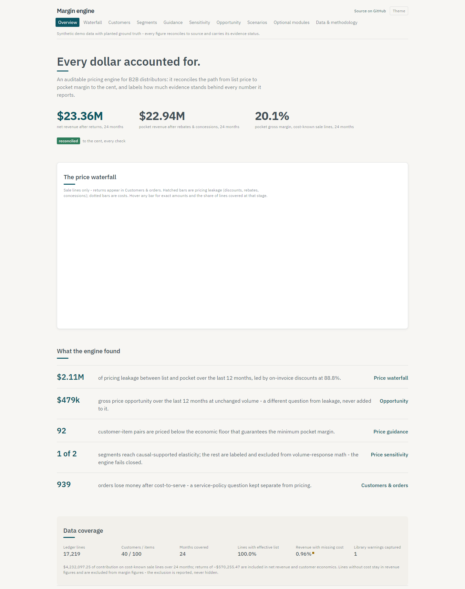

# Margin Engine

**An auditable pricing and margin decision engine for B2B distributors.**
It ingests ERP invoice exports, reconciles every dollar to the cent, and shows where margin leaks, what each customer actually contributes, and how much evidence stands behind every number.

**[Live demo](https://jjdlg45.github.io/margin-engine/)**: a static site presenting the engine's results on a fixed-seed synthetic world.



Built for industrial, electrical, HVAC, plumbing, and foodservice distribution: any business with negotiated prices.

---

## The problem

Distributor pricing data is **messy** (returns, credit memos, duplicates, missing costs, mixed units) and **endogenous** (reps discount when demand is weak, so realized prices move with demand the data can't see). Tools that ignore the first produce numbers that don't reconcile. Tools that ignore the second recommend price increases based on elasticities biased toward zero.

This engine is built around three rules:

1. **Accounting first.** Every revenue, deduction, and cost reconciles to source totals exactly, in integer cents. Allocations use the largest-remainder method, so every line sums back to its source. No dollar is silently dropped, and nothing is forced onto lines to make a report look complete.
2. **Proven, not claimed.** A synthetic-data generator plants known truth (segments, elasticities, rebates, outliers, rep discounting bias, instruments), and the test suite measures recovery across random seeds.
3. **Fail closed.** When the data doesn't support a result, the engine says so (`insufficient_data`, `insufficient_precision`, `descriptive_elasticity`) instead of printing a confident-looking number.

## What it produces

| Output | Answers |
|---|---|
| Price waterfall: list → invoice → pocket → gross profit → contribution | Where is margin leaking: discounts, rebates, freight, returns? |
| Peer-group dispersion and outliers | Who pays far more or less than comparable customers for the same item? |
| Commercial segments | Which customer × product groups behave alike on price? |
| Price guidance with an economic floor | What's the reference band, and what's the lowest price that still clears minimum margin? |
| Price sensitivity with evidence status | How does volume respond to price, and is that estimate causal or only descriptive? |
| Opportunity sizing (three levels, never summed) | How much is recoverable at fixed volume vs. after the expected volume response? |
| Order and customer economics | What does each order and customer contribute after returns and cost-to-serve? |
| Cost and tariff pass-through scenarios | What happens to margin at 0–100% pass-through? |
| Action center: findings become proposed actions, reviewed maker-checker, exported to the ERP, then measured | Which findings became decisions — and did they actually work? |
| Robinson-Patman review flags with the buyer facts beside them | Which recommended prices put possibly-competing customers far apart on the same item, and what would a reviewer need to judge it? (A prompt to look, not a finding - and not a safe harbor.) |

**Optional modules** switch on when their input data exists and say so when it doesn't: multi-currency, customer hierarchies and price-protected contracts, tiered retrospective rebates, kits and free goods, activity-based cost-to-serve, inventory costing (standard / average / FIFO / LIFO), key-value-item detection, quote win/loss curves, and cross-price effects within substitution groups. Analytic periods follow a configurable **fiscal calendar**: calendar months (default), 4-4-5 / 4-5-4 / 5-4-4 retail week calendars, or a custom period table — one declaration drives the sensitivity panel, peer-group quarters, baseline windows and the monthly GL variance check, while data-declared periods (rebate settlements, FX months) always stay as the source states them.

## Quickstart

```bash
uv sync

# Run on the committed sample data
uv run python -m margin_engine.cli run \
    --data data/sample/erp \
    --mapping config/mappings/synth_erp.yaml \
    --out output

# Open output/report.html. Tables are also in output/*.csv and *.parquet.
```

Generate a larger synthetic world (deterministic per seed):

```bash
uv run python -m synth.generate --out data/demo --seed 42
uv run python -m margin_engine.cli run --data data/demo/erp --mapping config/mappings/synth_erp.yaml --out output
```

Quality checks:

```bash
uv run ruff check .
uv run python -m mypy src
uv run python -m pytest
```

On Windows, run the dev tools as modules (`python -m pytest`, `python -m mypy`); Smart App Control blocks the unsigned shim executables.

### Web demo

The hosted site reads a JSON bundle exported by the engine:

```bash
uv run margin-engine export-web --demo --out web/public/data
cd web && npm install && npm run dev
```

`--demo` generates a fixed world (seed 3, 50 customers × 120 items, ~25k lines): the smallest scanned scale at which a segment reaches causal-supported elasticity under the Run 4 evidence criteria, so the site shows both the fail-closed and the supported path. CI rebuilds the bundle at deploy time; it is never committed. Every figure on the site comes from the engine's exports, and parity tests check them to the cent.

### Going live

The demo is static hosting, but the UI is already structured for a live
deployment behind a backend-for-frontend (BFF):

- **One data client, two adapters.** Every page reads through a single
  data-client interface ([`web/src/lib/api/types.ts`](web/src/lib/api/types.ts))
  using TanStack Query hooks - no component fetches JSON directly. The
  `static` adapter reads the exported files (GitHub Pages); the `http`
  adapter talks to the BFF. `VITE_DATA_SOURCE=http` selects the latter at
  build time ([`web/src/lib/api/client.ts`](web/src/lib/api/client.ts));
  anything else means static, so the hosted demo can never silently depend
  on a server.
- **The contract exists today.** [`docs/api/openapi.yaml`](docs/api/openapi.yaml)
  specifies the BFF: one aggregated endpoint per page plus paginated table
  endpoints (`page`, `page_size`, `sort`, named filters → `items`, `total`,
  `has_more`). The static adapter implements the same contract - filters,
  sorting and pagination behave identically, so swapping adapters changes
  transport, not behavior.
- **The BFF owns the server-side concerns:** response caching (results are
  immutable per engine run, so cache keys include the run manifest hash),
  rate limiting, pagination over large tables, and any server-side
  computation. The browser formats and filters; it never recalculates
  financials.
- **The export is already split** into per-page and per-table files, each
  under 1 MB, so the Overview loads only its own data and the other pages
  fetch lazily - the same request shapes the BFF would serve. Loading,
  error-with-Retry and partial-data states are handled at every section, with
  retries capped (two, exponential backoff, none on 4xx).

### Live mode

The BFF exists (Run 4, [`api/`](api/)): a FastAPI service implementing
[`docs/api/openapi.yaml`](docs/api/openapi.yaml) exactly, with engine outputs
and connector caches in DuckDB, ETag/Last-Modified response caching, inbound
per-client rate limiting (429 + Retry-After) and scheduled refreshes (FX
daily, PPI monthly) through the rate-limited [connectors](docs/data-sources.md)
— the API never calls an external source inside a request handler.

No free source publishes live B2B invoices, so live data is simulated
honestly with a **replay feed**: the Online Retail II dataset is fed in one
business day at a time, the engine re-runs, and the UI shows "Data as of
<day>" with the data labeled *historical data replayed*. Replay ticks are
idempotent (each day's world is filtered from source, never appended), so
re-running a day cannot double count.

Run everything locally with one command (Docker-free; see
[docs/deploy-api.md](docs/deploy-api.md) for hosting options):

```bash
uv run python scripts/live_mode.py          # UI :4174 in API mode, API :8321, replay on
```

### Run with Docker

One command starts the whole stack — a one-shot job exports the deterministic
demo bundle and action seeds, the API (with its in-process refresh scheduler)
serves it, and nginx serves the built UI with `/api` proxied same-origin:

```bash
docker compose up --build
# UI:  http://localhost:8080
# API: http://localhost:8000/api/health
```

State (the API's DuckDB stores, the action store with its review history, and
drift baselines) persists in the `state` volume across restarts; `docker
compose down -v` resets everything. Set `MARGIN_API_REPLAY: "1"` on the `api`
service in [`compose.yaml`](compose.yaml) to turn on the replay feed. CI
builds the images and smoke-tests the composed stack on every push
([`.github/workflows/docker.yml`](.github/workflows/docker.yml)) — GitHub's
runners have Docker even when the development machine does not.

## Action center

Analysis that nobody acts on is a report, not an engine. The Action center
closes the loop from finding to decision to measured outcome:

- **Generation.** The engine turns its own outputs into proposed actions —
  price changes, below-floor fixes, cost pass-through, service-policy reviews,
  rebate/discount reviews — each deterministic, with a plain-English rationale
  whose every number comes from the exports, an evidence status, and an
  expected impact at the *right* opportunity level for its type (levels are
  never summed across types). Guardrails are enforced at generation: no
  proposal below the binding floor, contract-protected pairs generate blocked
  actions that can never be approved, expected volume response only where the
  elasticity is causal-supported *and* the move sits inside identifying price
  support, and Robinson-Patman flags travel with the action.
- **Maker-checker review.** Lifecycle proposed → under review → approved /
  rejected → exported → implemented → measured, recorded as an append-only
  event log whose current status is derived by replay — never edited in place.
  Roles are analyst (proposes, edits, exports, implements), approver (approves
  or rejects — never an action they proposed themselves) and viewer. Approving
  a compliance-flagged action requires a written justification.
- **Two identity modes.** `local` (the default) takes a configured user name
  from a header: convenient for one person on one machine, and *not*
  authentication — anyone who can reach the port can be anyone. `production`
  rejects client-supplied identity outright, issues bearer tokens against
  accounts with PBKDF2-hashed passwords or an OIDC provider, decides every
  authorisation on an **immutable user id** rather than a display name, keeps
  an audit log that holds the record and none of the secrets, and refuses to
  start unless the operator has declared the state directory encrypted.
  Details in [`docs/deploy-api.md`](docs/deploy-api.md).
- **ERP price export.** `margin-engine export-prices` writes approved price
  actions as an ERP-importable price file (header names, date format, decimal
  separator and price unit configurable per deployment), deterministic and
  idempotent — re-exporting rewrites identical bytes and logs no duplicate
  events. A round-trip test re-imports the exported file through the engine's
  own ingest and matches every price to the cent.
- **Results tracking.** `margin-engine track` measures implemented actions
  after a configurable window: price realization (did the invoiced price
  actually move, or erode back?), volume against the prediction stored on the
  action at generation time, and margin before vs after. The per-action volume
  figure is a **control-adjusted volume change** — the treated pair's ratio
  divided by the trend in clean untreated pairs in the same segment — and is
  deliberately not called a difference-in-differences estimate. A pair that
  stops buying counts as a change of zero rather than being dropped, on both
  sides of the comparison. Alongside it, a **pooled event study** compares
  treated pairs with never-treated and not-yet-treated ones over event time,
  states its estimand, and reports the pre-trend check with the size of
  pre-trend the data could have detected. Every gate fails closed with its
  reason; calibration by evidence bucket appears only once enough actions are
  measured. On synthetic worlds with planted price interventions the tracker's
  pooled recovery error is 0.039 log points (see the validation table), and on
  a sparse world it measures nothing and says why.

The hosted demo runs the Action center as a **sandbox**: it starts from a
simulated, lifecycle-valid review history (labeled as such), and every
workflow button works — propose, edit, approve, reject, bulk approve, price
export and mark implemented — under the same guardrails as the API. Sandbox
changes live only in the visitor's browser (a banner says so, with a Reset
demo button and an analyst/approver identity switcher); business numbers
still come only from the engine's exports. In API/live mode the same
workflow runs server-side with the review history in DuckDB.

## Use it with your own data

The short path from a raw ERP export to results (the hosted demo also walks
through it on its "Use it with your own data" page):

1. **Install:** `uv sync` from a clone, or `docker compose up --build` for
   the full stack ([Run with Docker](#run-with-docker)).
2. **Map the export:** `margin-engine profile <file>` reports what each
   column looks like; `margin-engine draft-mapping <file>` writes a mapping
   draft in which every guess is marked `# CONFIRM` — the engine refuses to
   run until a person has confirmed each one
   ([Running on real data](#running-on-real-data)).
3. **Run:** `margin-engine run --data <file> --mapping <yaml> --out output`
   and open `output/report.html`; add `export-web` to browse results in the
   web app.
4. **Tie out to the books:** map an optional `gl_totals` table and the
   report compares engine monthly totals to the general ledger, flagging
   failing months instead of hiding them.
5. **Go live:** `uv run python scripts/live_mode.py` serves the UI in API
   mode with scheduled refreshes and drift flags ([Live mode](#live-mode)).
6. **Work the actions:** the [Action center](#action-center) turns findings
   into reviewed, exported, measured price actions.

## Supported input formats

The engine reads **tabular, line-level invoice exports**: one row per invoice line, as **CSV** or **.xlsx**. PDF and scanned invoices are not supported; they need a separate extraction step first.

Physical format is declared in the mapping, never guessed:

| Option | Default | Meaning |
|---|---|---|
| `delimiter` | `,` | CSV field separator: `,` `;` tab or `\|` |
| `encoding` | `utf-8` | Any Python codec (e.g. `windows-1252`); a UTF-8 BOM is always handled |
| `currency_symbols` | `[]` | Symbols stripped from money values, e.g. `["$"]`, `["MXN"]` |
| `negative_format` | `minus` | `minus` for `-113.57`, `parentheses` for `(113.57)` |
| `trim_whitespace` | `true` | Strip surrounding whitespace from headers and values |

Reference tables may also map optional display names - `customer_name` on the
customers table, and `item_description`, `supplier_name`, `category_name` on
the items table. When present, the demo UI and report show names first with
the ID secondary ("Gulf Coast Mechanical Supply · C10031") and search
matches either; when absent, IDs are shown alone.
| `decimal_separator` | `.` | `,` for `1.234,56`-style numbers |

Options set globally under `input:` can be overridden per file (`lines_input:` for the invoice lines, `input:` on any reference table), for example semicolon-delimited invoice lines alongside a comma-delimited price list. Blank rows are dropped and counted in the run manifest. A wrong declaration fails with a message naming the likely cause and the option to set.

## Running on real data

1. `margin-engine profile your_export.csv` scans the file and reports, per column: type guess, null rate, distinct count, detected date formats, and candidate canonical fields each with a confidence and a reason — plus the file-level delimiter, encoding, decimal separator and sign patterns.
2. `margin-engine draft-mapping your_export.csv` turns that into a mapping YAML in which **every guessed value is marked `# CONFIRM`** and listed under `unconfirmed_fields`. The engine refuses to run a mapping while that list is non-empty: a person confirms each guess by reviewing and deleting its entry. Suggestions never become silent decisions.
3. Declare the semantics that matter: the sign convention of every amount, whether discounts are embedded, the cost basis and what it includes — or declare their honest absence (`cost_unavailable: true` when the source genuinely has no cost; a prefix rule when the transaction type lives in the document number). Every reference table is optional; absent tables switch their features off and the report says so.
4. The engine refuses to compute anything whose meaning you didn't declare and tells you exactly which declaration is missing.

No code changes are needed for a new source system. Three more tools exist for real deployments:

- **Monthly GL variance check.** Map an optional `gl_totals` table (month, net sales, COGS, optionally returns) and the report compares engine period totals to the books: net sales and COGS separately, with signed and absolute variances, guarded variance percentages, the tolerance used, the fiscal-period and account mappings, unresolved reconciling items, and a line-to-GL trace sample. Variances outside tolerance are flagged, never hidden; without a GL file the check reports not testable instead of implying a pass. It is a variance control on top of the always-on, exact source-total reconciliation.
- **Validation without planted truth.** Real data has no ground truth, so every run includes checks that remain possible: a temporal backtest (fit on months 1..T−k, held-out volume-change prediction error vs a zero-elasticity baseline), placebo tests (instruments permuted in time must lose their reduced form and first stage; fake price-change dates must show no volume response), and rolling-window stability for both elasticities and segments. All informational — on the real case study below they correctly argue *against* causal claims.
- **Anonymizer.** `margin-engine anonymize` replaces customer, item and supplier IDs and names with salted keyed hashes (HMAC-SHA256; referential integrity preserved, so the same mapping runs on the copy) and can scale every money column by a secret salt-derived factor. The salt comes from a local file or environment variable and never appears in any output or manifest.

## Case study: Online Retail II (real data)

The engine runs end to end on a real public dataset: the UCI **Online Retail II** export of **real UK online-retail transactions (giftware); many customers are wholesalers** — 1,067,371 invoice lines, 2009–2011, GBP, with real cancellations, 14.7% of revenue from anonymous customers, non-product fee codes and true duplicate rows, and **no cost, no list price, no instruments**. Every reconciliation check passes exactly (GBP kept per line, converted to USD at monthly ECB reference rates); cancellations classify as returns via a one-line mapping prefix rule; cost-dependent metrics report `cost_unavailable` instead of numbers; elasticity caps at `descriptive_elasticity`, and the no-planted-truth checks show why that gating is right (the backtest loses to a zero-elasticity baseline out of sample; fake-date placebos "detect" effects that cannot be real). **What this case study tests is ingestion and descriptive analytics**: the dataset has no cost, no list price and no instruments, so it exercises mapping, classification, reconciliation, dispersion and segmentation, and it cannot test margin, floors or causal price response - which is why the engine reports those as unavailable rather than producing them. Full write-up: [`docs/case-study-online-retail.md`](docs/case-study-online-retail.md); reproduce with [`scripts/download_online_retail.py`](scripts/download_online_retail.py).

## Validation results

Planted truth vs. recovered, on synthetic data. These figures are produced by `scripts/measure_validation.py`, which runs the actual measurements and writes `docs/validation.json`; the demo site reads the same file. No number here is hand-typed: the table is generated from that file by `scripts/sync_validation_table.py`, and `tests/test_validation_table.py` fails if the two ever disagree.

<!-- validation-table:start -->

Measured 2026-10-26T20:23:17+00:00 by `scripts/measure_validation.py` in 62 minutes. This table is generated from `docs/validation.json`; a test fails if the two disagree. Method and scope for every row - what it establishes and what it does not - are in [`docs/validation.md`](docs/validation.md).

| Check | Target | Measured | Worlds or clusters |
|---|---|---|---|
| Accounting fixtures | Exact to the cent | All hand-calculated fixture tests pass | hand-calculated cases, not worlds |
| Ledger reconciliation | Exact to source totals after rounding | Property suite passes (hypothesis-varied inputs) | hypothesis-generated inputs, many per run |
| Rebate / freight recovery | Actual amounts exact; allocated within ±5% of planted | Recovery suite passes (exact + ±5% allocated) | fixtures plus one planted world |
| Planted outlier detection | ≥ 90% recall, ≤ 5% false-flag rate | Recall 98.7%, false-flag rate 1.02% | 1 |
| Commercial segments vs planted (out-of-sample ARI) | At least 0.70 on the well-identified preset | ARI 1.000 (seed 3, default scale) | 1 |
| Segment stability (bootstrap median ARI) | ≥ 0.80 | Median ARI 1.000 over 8 resamples | 1 |
| Elasticity recovery, planted grain, 5 seeds | Median abs error ≤ 0.10; P90 ≤ 0.15 (worst reported) | Median 0.019, P90 0.077, worst 0.095 | 5 |
| Elasticity recovery, end-to-end (engine segments), 5 seeds | Median abs error ≤ 0.10; P90 ≤ 0.15 (worst reported) | Median 0.022, P90 0.077, worst 0.095 | 5 |
| Naive estimator bias | Biased in the planted direction (toward zero) on every seed | Toward zero on 5/5 seeds, every segment | 5 |
| Causal support reachable | Reached on the well-identified preset with all criteria enforced | Reached; competitor-price path controlled_by_market_index; market index market_control_adequate | 1 |
| Competitor-price path gate | Informational: how the Phase 70 gate lands on the well-identified preset | 13/30 segment-seeds reach causal support; 17/30 are just-identified after controlling (a category tariff instrument is itself a category market-price mover, so holding the market price constant leaves the supplier cost shock as the identifying variation) | 30 segment-seeds |
| Anticipation (lead) test false-rejection rate | Informational: on the well-identified preset no anticipation channel is planted, so every rejection is a false positive | 0/30 segment-seeds rejected as material, 25 passed, 0 detected but below the materiality threshold, 0 reported inconclusive for lack of power; smallest detectable effect 0.00-0.01 log-volume units where it passes | 30 segment-seeds |
| Robust first-stage statistic and robust-set shape | Informational: the Montiel Olea-Pflueger effective F against the published 23.109 bar, and the shape of the weak-instrument-robust set | Effective F 361-1985 (heuristic Wald/K 584-3926); robust set interval x30; total accepted width 0.04-0.86 | 30 segment-seeds |
| 95% CI coverage, 50 simulations | Covers truth 90-98% of the time | 284/300 = 94.7% | 50 simulations, 300 intervals |
| 95% CI coverage under persistent demand, cluster=month (alternative, informational) | Informational - reported to justify the clustering default | 253/300 = 84.3% | 50 simulations, 300 intervals |
| 95% CI coverage under persistent demand, cluster=month_customer (shipped default) | Covers truth 90-98% of the time | 278/300 = 92.7% | 50 simulations, 300 intervals |
| 95% CI coverage under persistent demand, cluster=supplier_month (alternative, informational) | Informational - reported to justify the clustering default | 244/300 = 81.3% | 50 simulations, 300 intervals |
| weak-instrument preset | Never reaches causal support; weak-IV-robust interval reported | No segment reached causal support; Anderson-Rubin set reported | 5 |
| invalid-instrument preset | Overidentification rejects on ≥ 80% of seeds; status downgraded | Rejected on 4/5 seeds; downgraded on 5/5 | 5 |
| price-constant preset | Insufficient data or descriptive only - never higher | Held for every segment | 1 |
| sparse preset | Insufficient data or descriptive only - never higher | Held for every segment | 1 |
| Misspecified world: persistent_demand (informational) | Informational - reported, not gated (the planted beta is not the estimand under misspecification) | median abs error vs planted 0.031; statuses {causal_elasticity_supported: 8, descriptive_elasticity: 1, iv_estimated_elasticity: 9} | 1 |
| Misspecified world: heterogeneous_elasticity (informational) | Informational - reported, not gated (the planted beta is not the estimand under misspecification) | median abs error vs planted 0.025; statuses {causal_elasticity_supported: 9, descriptive_elasticity: 1, iv_estimated_elasticity: 8} | 1 |
| Misspecified world: nonconstant_elasticity (informational) | Informational - reported, not gated (the planted beta is not the estimand under misspecification) | median abs error vs planted 0.303; statuses {causal_elasticity_supported: 9, descriptive_elasticity: 1, iv_estimated_elasticity: 8} | 1 |
| Misspecified world: competitor_comovement (informational) | Informational - reported, not gated (the planted beta is not the estimand under misspecification) | median abs error vs planted 0.236; statuses {descriptive_elasticity: 18} | 1 |
| KVI candidates | ≥ 80% of planted KVIs in top-ranked candidates | Recall 96.7% (30 planted) | 1 |
| Win-curve price coefficient | Within ±15% relative of planted, per estimated segment | Worst estimated segment 4.0% (2 estimated, precision-gated) | 1 |
| Engine determinism | Byte-identical bundle across runs on the same input | Byte-identical | one world, repeated runs |
| Performance (full Run-1 pipeline) | 500k+ lines under 2 minutes | 811,253 lines in 119.0s on AMD64 (Windows) | one world, one machine |
| Competitor-price path gate (informational) | Informational - reported, not gated: how the Phase 70 gate lands on the well-identified preset | 13/30 segment-seeds reach causal support; 17/30 are just-identified after controlling (a category tariff instrument is itself a category market-price mover, so holding the market price constant leaves the supplier cost shock as the identifying variation) | 30 segment-seeds |
| Scenario matrix (full tier) | every invariant holds on every world (reconciliation, fail-closed, determinism, format invariance, monotonicity, no crash) | 300 worlds, 300 passed all invariants, 0 failed (0 crashes), 1784s | 300 |
| Hybrid world: real PPI cost paths (informational) | informational: recovery when real cost movements drive the instrument | seed 11, 3 real PPI series as supplier cost paths (series log sd [0.049, 0.033, 0.003]); median abs elasticity error 0.037 over 6 segments; statuses {'causal_elasticity_supported': 4, 'iv_estimated_elasticity': 2}; 12s | 1 |
| Scale (10M-line pipeline) | 10M+ lines under 15 minutes and under 8 GB peak memory | largest run that fits this machine: 241,162 lines in 13.0s, peak 2.64 GB on AMD64 (Windows), 13.8 GB RAM, 5.2 GB available at start; slowest stages: exports 3.3s, sensitivity 3.2s, ingest classify waterfall reconcile 3.1s, segmentation 1.9s. KNOWN GAP: the 10M-line target could not be verified on this hardware (next rung 450x700 projected ~5.3 GB peak, over the 4.2 GB budget on this machine); the pipeline's memory use is linear in lines across the measured rungs, but that is an extrapolation, not a measurement. | one ladder, one machine |
| Results tracker: planted-intervention recovery | pooled recovery \|median DiD effect - median planted effect\| <= 0.1 log points and >= 50% of interventions measured (well-identified world, seed 5, 30 planted +8% interventions; a single pair's 90-day window carries ~0.2-0.3 log points of Poisson noise, reported as information) | 21/30 measured; pooled recovery error 0.0394 log points; per-pair median abs error 0.2562, P90 0.6419 | 1 |
| Results tracker: fail-closed on a sparse world | <= 25% of interventions get a number; the rest report insufficient evidence with reasons (sparse preset, same interventions) | 0/30 measured (0%); refusal reasons: {'not enough sales around the implementati': 30} | 1 |

<!-- validation-table:end -->

Rows marked informational are reported, not gated: once the model is misspecified the planted number is no longer the estimand the engine is estimating, so recovering it is not the right test. They are kept in view because clean synthetic results overstate real-world accuracy, and the misspecified worlds are where that shows.

## Method in brief

A mapping YAML declares column names and business meaning; ingestion fails actionably on anything undeclared. Classified transactions produce two views (clean sales observations and a complete financial ledger) and a staged waterfall with exact allocations. Prices normalize to an index against the effective-dated list price; robust z-scores flag data-quality anomalies and commercial outliers separately. Commercial segments come from a decision tree on the price index using context features only. Every feature declares its lineage and the guard refuses any that embeds the realized price, so a feature cannot pass on an innocent name; the ABC class is cut on a window that ends before the line's own period, order-size bands on quantity rather than value, and the target encoding out of fold. Segments are checked for stability by bootstrap and scored on later months the tree never saw. Price guidance is historical reference bands against an exact economic margin floor, rounded up so it always clears minimum margin. Own-price elasticity is estimated per segment by fixed-effects instrumental-variables regression with two instruments (supplier cost index, category tariff rate), and first-stage, overidentification, robustness, and weak-IV-robust diagnostics feed a four-level evidence status. Opportunity is sized at three levels that are never added together. Findings become proposed actions with guardrails, reviewed maker-checker, exported to the ERP and measured after implementation. Full detail: [`docs/methodology.md`](docs/methodology.md).

## Independent review

An independent methodology review raised 24 findings about the gap between
what the labels promised and what the methods delivered. Most of the
remediation is subtraction: numbers that used to appear now refuse to.
Three results make the engine look worse on its own demo and are correct —
both win curves fell to `insufficient_precision` once standard errors stopped
treating 676 quotes from 24 customers as independent; one commercial segment
disappeared when features embedding the price being explained were removed
(bootstrap stability rose 0.737 → 0.884); and the spill-to-Parquet scale path
was measured as not lowering peak memory, so it ships off by default saying
so. Finding by finding, with before/after numbers and what is still open:
[`docs/run6-report.md`](docs/run6-report.md).

## Honest labels and limitations

- **Historical reference bands are not optimal prices.** Targets stay `provisional_historical` unless elasticity evidence supports optimization.
- **Descriptive elasticities are not causal.** The naive estimate is reported to document bias, never used for decisions.
- **Instruments rest on assumptions.** The overidentification test only detects an invalid instrument when the two instruments disagree; exclusion restrictions are documented per instrument in `config/rules.yaml`.
- **Industry-wide cost shocks also move competitor prices.** A customer facing an industry-wide increase has nowhere cheaper to go, so measured responses are flatter than the response to a unilateral move: estimates **understate** own-price sensitivity, and overidentification cannot detect it because both instruments shift competitor prices in the same direction. Since Run 6 this is a **gate**, not a caveat: `causal_elasticity_supported` requires either an adequate public market price index (current, complete, varying within each period, at a grain matching the channel, and demonstrably related to prices) or an instrument whose competitor-price path is documented as absent with a written argument. Otherwise the status caps at an instrumented estimate, the estimand is reported as a market-wide cost-shock response with its bias direction, and the two-sided expected-change range is withheld. No configuration switch disables this. The gate still cannot discharge a violation the two instruments share through some other channel - that limitation is stated in the methodology and the status tooltip.
- **One elasticity per segment is an assumption, and the check on it is narrow.** Each segment's instrumented estimate is re-run on its cheaper-priced and its dearer-priced pairs; causal support is withdrawn only when the two differ by more than 0.30 *and* by more than the comparison can resolve. On the hosted demo world the one causal-supported segment comes out **inconclusive** - its halves differ by 0.26 against a detectable bound of 0.35 - so the assumption behind that causal label is untested rather than confirmed, and the page says so. The comparison is made between comparable customers for the same item, which in these worlds separates the halves by about four percentage points of price: it catches curvature visible there, and reports `functional_form_inconclusive` rather than agreement when it cannot.
- **An untested price-response shape narrows what the engine will price.** Where the comparison above is inconclusive, the evidence status is left alone - a test with no power to speak is not evidence against - but the segment gets no optimal price, and a modeled volume response only inside half its identifying range (configurable). Beyond that the figure assumes unchanged volume and is labeled `price_response_shape_untested`. The page shows "Price-response shape untested" beside the status. On the demo world this moves 60 of 611 opportunity records to unchanged volume.
- **An elasticity describes the prices it was estimated at.** On a planted curved-demand world the engine's estimates look 0.303 away from the planted number, but that number is the elasticity at the item's list price and sold prices sit about 11% below list. Scored against the local elasticity at the prices actually in the sample, the median absolute error is 0.039. The engine never prices a move outside the range it has evidence for - that is what `outside_price_support` is for - and this is the measurement behind that rule.
- **Volume responses are never extrapolated** beyond the price variation the instruments actually induced: proposed moves outside each segment's identifying price range are labeled `outside_price_support` and sized at unchanged volume.
- **Allocated and estimated amounts are labeled** as such, never presented as actuals. Unallocatable amounts stay visible as residuals with a plain-English explanation.
- **Item availability is proxied** by market-wide activity, since stockouts aren't observable in invoice data. The proxy is labeled.
- **Synthetic validation is not real-world validation.** Tests demonstrate recovery of planted truth; they don't prove accuracy on any specific company's data.

## Repository layout

| Path | Contents |
|---|---|
| `src/margin_engine/` | Engine: ingest, ledger, waterfall, analytics, models, report, web export |
| `synth/` | Synthetic world generator with planted ground truth |
| `config/` | Mappings (columns + semantics) and `rules.yaml` (policy and thresholds) |
| `tests/` | Accounting fixtures, property tests, input-format tests, recovery and coverage studies |
| `web/` | React + TypeScript demo site with Playwright and accessibility tests |
| `scripts/` | Validation measurement script |
| `docs/` | `methodology.md`, `metric-dictionary.md`, `validation.json` with its scope in `validation.md`, `run6-report.md` (the independent-review remediation), design plan, and UI review screenshots |
| `data/sample/` | Small committed demo dataset |

## Author

**Juan Ignacio Jimenez**, Industrial Engineer · [LinkedIn](https://linkedin.com/in/juan-ignacio-jimenez)

## License

Copyright © 2026 Juan Ignacio Jimenez. All rights reserved.
This repository is shared for portfolio review. No license is granted to use, copy, modify, or distribute this code without written permission.